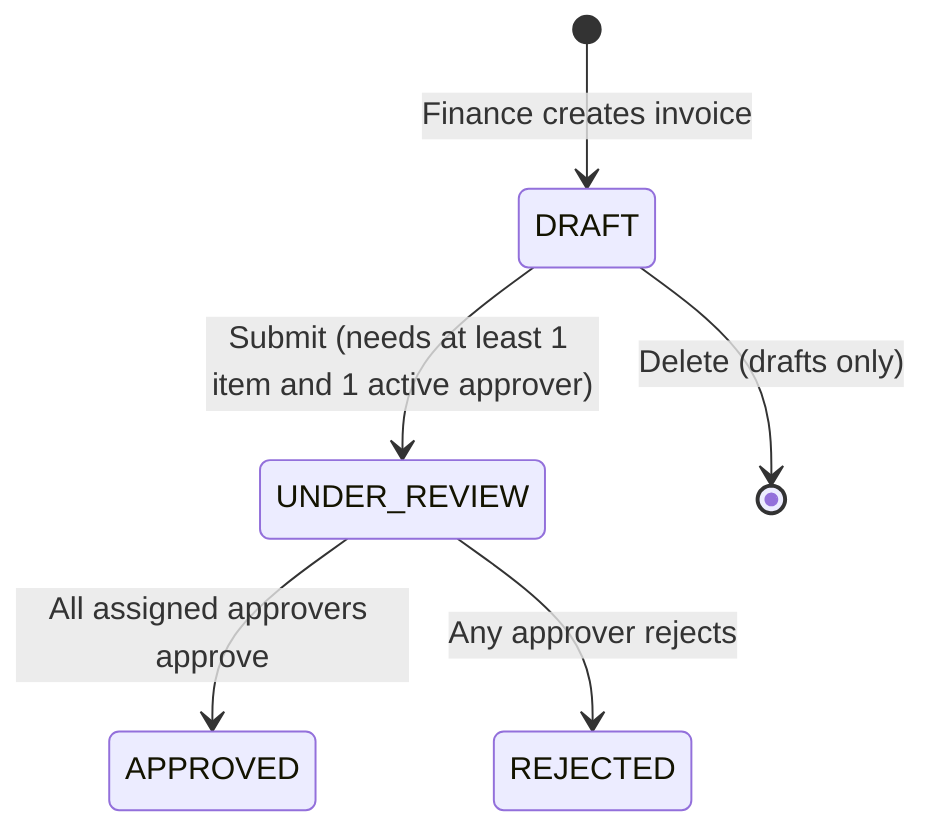
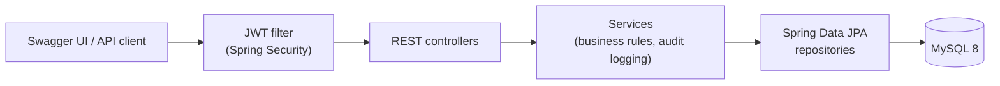

# Enterprise Invoice Management System

[](https://github.com/Nazeem59/invoice-management/actions/workflows/ci.yml)


A REST API for supplier invoice processing, built with Java 21 and Spring Boot. It covers JWT authentication, role-based access control, an invoice approval workflow, an audit trail, and financial dashboard reports.

**Live demo:** [Swagger UI](https://invoice-management-1qbd.onrender.com/swagger-ui/index.html) (hosted on Render's free tier, so the first request may take about a minute while the service wakes up). Log in with any of the [demo accounts](#quick-start-docker) below.

## What this project demonstrates

- **Stateless security:** Spring Security with a custom JWT filter, BCrypt password hashing, and role-based authorization on write, approval, and audit endpoints.
- **A real approval workflow:** a submitted invoice is assigned to every active approver. It becomes `APPROVED` only when all of them approve, and a single rejection moves it to `REJECTED`.
- **Auditability:** every create, update, submit, approve, and reject action is recorded with the acting user and the old and new values.
- **Layered design:** controllers, services, repositories, DTO records with Jakarta validation, and centralized exception handling.
- **Reproducible delivery:** Docker Compose for local runs, schema validation instead of auto-DDL, and a GitHub Actions pipeline that builds and tests against a real MySQL service.

## Approval workflow



Rules enforced by the service layer:

- Only `DRAFT` invoices can be edited, deleted, or submitted.
- Only `FINANCE` and `ADMIN` users can submit an invoice; only `APPROVER` users can approve or reject.
- Invoice totals (subtotal, tax, total) are calculated on the server from the line items.
- An approver can decide only on invoices assigned to them, and only once per invoice.
- Decisions are accepted only while the invoice is `UNDER_REVIEW`.

## Architecture



More detail, including the deployment setup, is in [docs/architecture.md](docs/architecture.md).

## Tech stack

| Category | Technology |
|---|---|
| Language | Java 21 |
| Framework | Spring Boot 4.1.2 (Web MVC, Data JPA, Security, Validation) |
| Database | MySQL 8.0 |
| Authentication | JWT (JJWT 0.12.6) |
| API docs | springdoc OpenAPI / Swagger UI |
| Testing | JUnit 5, Mockito, Spring Boot Test, Spring Security Test |
| Build and delivery | Maven, Docker, Docker Compose, GitHub Actions |

## User roles

| Role | Can do |
|---|---|
| `ADMIN` | Everything `FINANCE` can do, plus read audit logs |
| `FINANCE` | Create, update, and delete suppliers and draft invoices; submit invoices for approval |
| `APPROVER` | Read suppliers, invoices, and dashboards; approve or reject invoices assigned to them |

Authorization is enforced in two places: URL rules in `SecurityConfig` (write operations on suppliers and invoices require `FINANCE` or `ADMIN`) and role checks in the approval and audit-log controllers. A user with the wrong role receives `403 Forbidden`; a missing or invalid token receives `401 Unauthorized`.

## Quick start (Docker)

Prerequisites: Docker Desktop (or Docker Engine with the Compose plugin) and Git.

```bash
git clone https://github.com/Nazeem59/invoice-management.git
cd invoice-management

# 1. Create your environment file
cp .env.example .env

# 2. Generate a JWT secret (base64-encoded 32 random bytes) and paste it into .env as JWT_SECRET
openssl rand -base64 32

# 3. Start MySQL and the API
docker compose up --build -d
```

On Windows PowerShell, use `copy .env.example .env` for step 1 and this for step 2:

```powershell
[Convert]::ToBase64String((1..32 | ForEach-Object { Get-Random -Maximum 256 }) -as [byte[]])
```

| Resource | URL |
|---|---|
| Swagger UI | http://localhost:8080/swagger-ui.html |
| OpenAPI JSON | http://localhost:8080/v3/api-docs |
| REST API | http://localhost:8080/api |
| MySQL (host access) | `localhost:3308` |

The database is initialized from `database/init/01-schema.sql` with three demo accounts. They all use the password `Demo@12345` and also work on the live demo:

| Email | Role |
|---|---|
| `admin@invoice.local` | `ADMIN` |
| `finance@invoice.local` | `FINANCE` |
| `approver@invoice.local` | `APPROVER` |

Stop the stack with `docker compose down`. Add `-v` to also delete the database volume and all stored data.

> Never commit `.env`. It is listed in `.gitignore`; only `.env.example` is tracked.

## Try the API

Log in, then use the returned token:

```bash
# Log in as the demo Finance user
curl -s -X POST http://localhost:8080/api/auth/login \
  -H "Content-Type: application/json" \
  -d '{"email":"finance@invoice.local","password":"Demo@12345"}'

# The response contains "accessToken". Export it:
export TOKEN="<accessToken>"

# Create an invoice (Finance or Admin)
curl -s -X POST http://localhost:8080/api/invoices \
  -H "Authorization: Bearer $TOKEN" \
  -H "Content-Type: application/json" \
  -d '{
        "supplierId": 1,
        "invoiceDate": "2026-11-19",
        "dueDate": "2026-12-19",
        "currency": "IDR",
        "description": "Office equipment",
        "items": [
          {"itemDescription": "Laptop", "quantity": 2, "unitPrice": 12000000, "taxRate": 11}
        ]
      }'

# Submit it for approval (Finance or Admin)
curl -s -X POST http://localhost:8080/api/invoices/1/submit -H "Authorization: Bearer $TOKEN"

# Approve it (log in as approver@invoice.local and export that token as APPROVER_TOKEN)
curl -s -X POST http://localhost:8080/api/invoices/1/approve \
  -H "Authorization: Bearer $APPROVER_TOKEN" \
  -H "Content-Type: application/json" \
  -d '{"comments":"Looks good"}'
```

## API overview

| Area | Endpoints |
|---|---|
| Auth | `POST /api/auth/login` |
| Suppliers | `GET/POST /api/suppliers`, `GET/PUT/DELETE /api/suppliers/{id}` |
| Invoices | `GET/POST /api/invoices`, `GET/PUT/DELETE /api/invoices/{id}` |
| Approval | `POST /api/invoices/{id}/submit`, `/approve`, `/reject`; `GET /api/invoices/{id}/approvals` |
| Dashboard | `GET /api/dashboard/summary`, `/status-summary`, `/outstanding-invoices`, `/approval-statistics`, `/monthly-spending`, `/supplier-report` |
| Audit logs (Admin) | `GET /api/audit-logs`, `/api/audit-logs/entity/{entityType}/{entityId}`, `/api/audit-logs/user/{userId}` |

Full request and response schemas are in Swagger UI.

## Testing

```bash
./mvnw clean verify
```

The suite contains unit tests for the service layer and controller integration tests for every module (auth, suppliers, invoices, approvals, dashboard, audit logs). The CI workflow runs the same command on every push and pull request to `main`, against a MySQL 8 service container.

## Security notes

- Passwords are hashed with BCrypt; sessions are stateless; CSRF, form login, and HTTP Basic are disabled because the API is token-based.
- Only `/api/auth/**` and the Swagger endpoints are public. Everything else requires a valid JWT.
- Secrets (database credentials and the JWT signing key) come from environment variables, never from source control.
- Hibernate runs with `ddl-auto=validate`, so the schema is controlled by `database/init/01-schema.sql` and the application only checks that it matches the entity mappings.

## Roadmap

- Multi-level approval chains (approval level is currently always 1).
- Endpoints for the `PAID` and `CANCELLED` invoice states.
- Database migrations with Flyway and integration tests with Testcontainers.
- Code coverage report and badge.

## Author

**Muhamad Nazeem Al Ghozali** — Java Backend Developer
