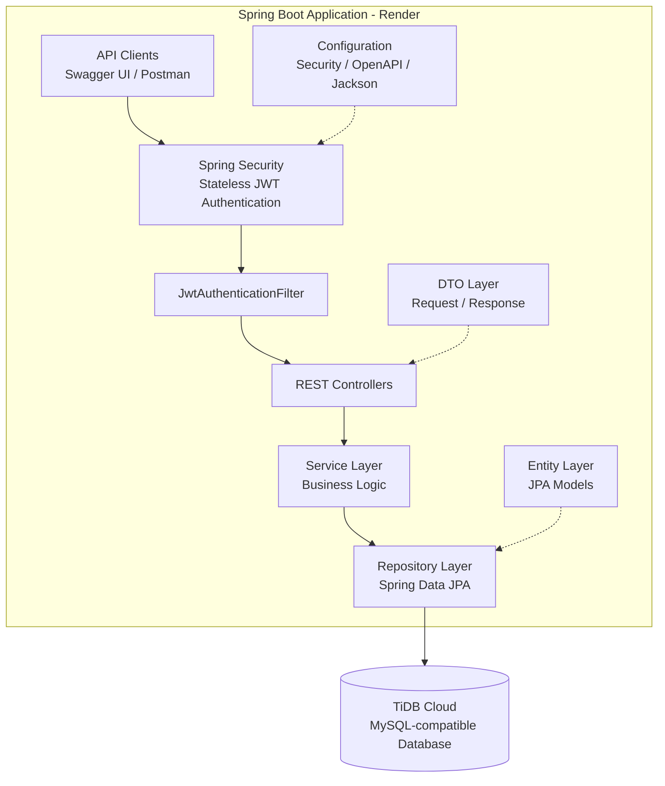
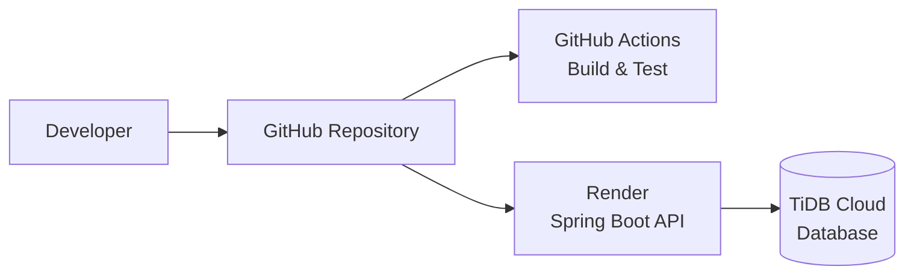

# Enterprise Invoice Management System
## System Architecture

### 1. Overview

Enterprise Invoice Management System is a RESTful backend application
built with Java and Spring Boot. It provides authentication,
supplier management, invoice processing, approval workflows,
dashboard reporting, and audit logging.

### 2. Application Architecture

### 3. Security Architecture

The application uses stateless JWT authentication.

1. The client submits credentials to the authentication endpoint.
2. Spring Security AuthenticationManager processes authentication.
3. The application issues a JWT after successful authentication.
4. The client includes the token in the Authorization header.
5. JwtAuthenticationFilter extracts and validates the token.
6. UserDetailsService loads the corresponding user.
7. A valid authentication is stored in SecurityContextHolder.
8. Protected endpoints require authentication.

**Security configuration:**
- Stateless session management.
- CSRF disabled.
- Form login disabled.
- HTTP Basic authentication disabled.
- JWT filter executes before UsernamePasswordAuthenticationFilter.
- Authentication and Swagger endpoints are publicly accessible.
- Other endpoints require authentication.

### 4. Main Business Modules

| Module | Responsibility |
|---|---|
| Authentication | Login and JWT token generation |
| Supplier Management | Supplier CRUD operations |
| Invoice Management | Invoice and invoice item processing |
| Approval Workflow | Invoice approval decisions |
| Dashboard | Summary, statistics, and reports |
| Audit Logging | Recording application activities |

### 5. Technology Stack

| Category | Technology |
|---|---|
| Language | Java |
| Backend Framework | Spring Boot |
| Web | Spring WebMVC |
| ORM | Spring Data JPA |
| Security | Spring Security |
| Authentication | JSON Web Token (JWT) |
| Database | TiDB Cloud / MySQL-compatible |
| API Documentation | Springdoc OpenAPI / Swagger UI |
| Validation | Jakarta Validation |
| JSON Processing | Jackson |
| Build Tool | Maven |
| Testing | JUnit / Mockito / Spring Boot Test |
| Deployment | Render |
| CI | GitHub Actions |

### 6. Database Configuration

The application connects to the database using environment variables.

- `DB_URL`
- `DB_USERNAME`
- `DB_PASSWORD`

Hibernate schema management uses `validate`, which checks
the database schema against the application's entity mappings.

### 7. Deployment Architecture

The production backend is hosted on Render and uses TiDB Cloud
as its managed MySQL-compatible database.

GitHub Actions is used for automated build and test workflows.

### 8. Production API

- API Base URL: https://invoice-management-1qbd.onrender.com
- Swagger UI: https://invoice-management-1qbd.onrender.com/swagger-ui/index.html
- OpenAPI Specification: https://invoice-management-1qbd.onrender.com/v3/api-docs

---

**Architecture Note:** This document describes the application's
current implementation and deployment at a high level.
